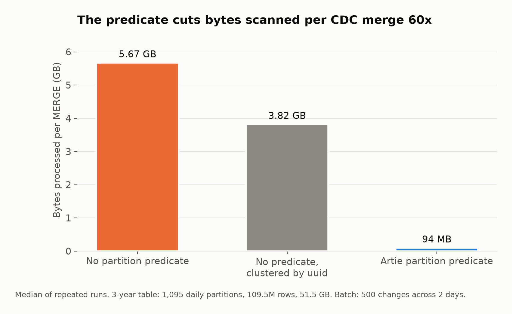
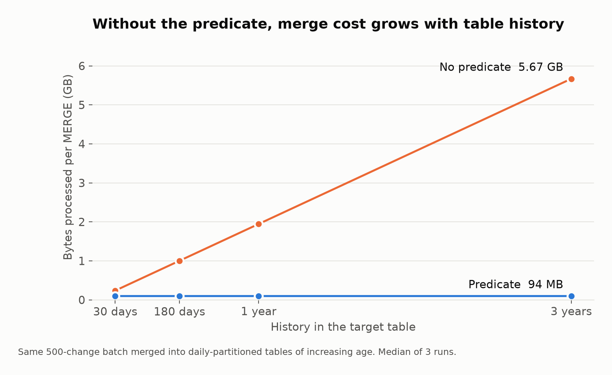
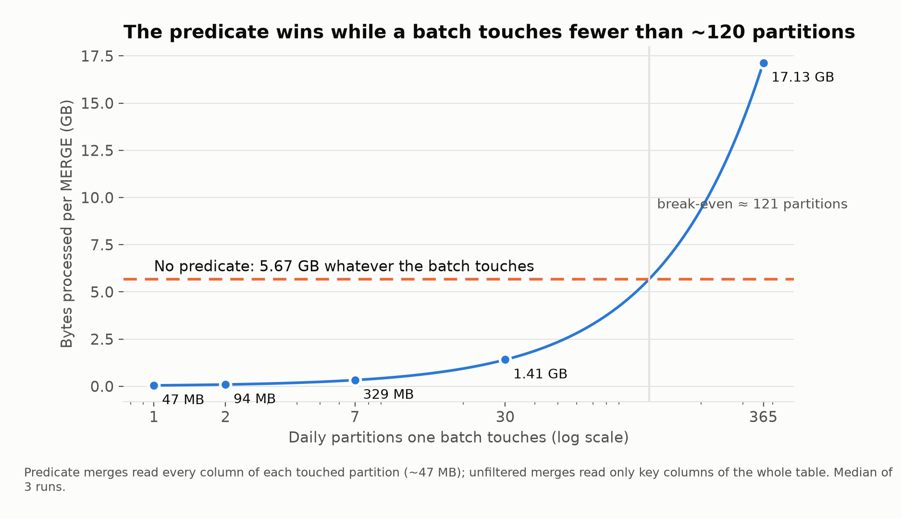
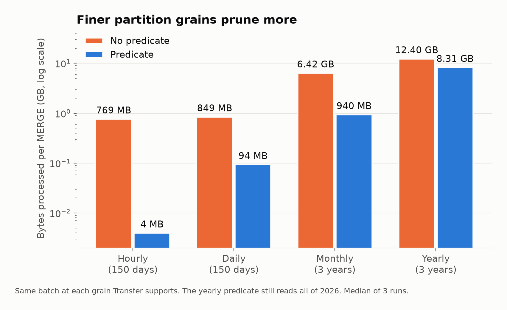
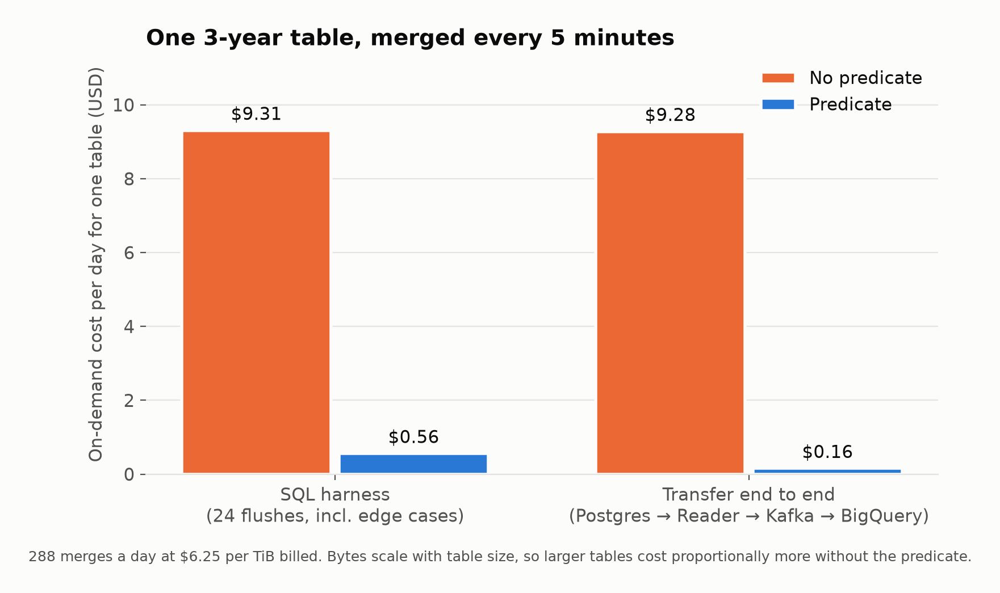
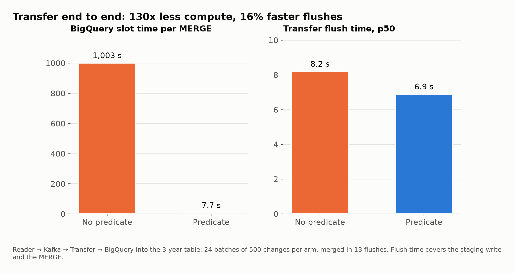
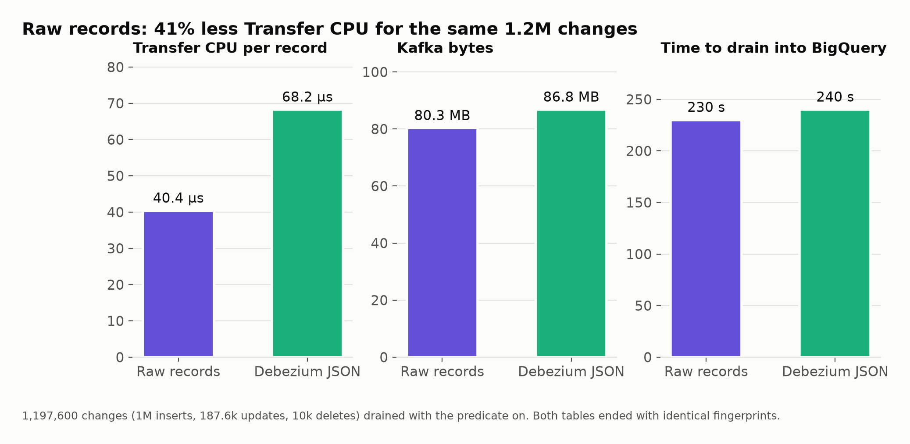

# BigQuery MERGE partition pruning

How much a partition filter (the charts call it the partition predicate) in the `MERGE` condition saves when CDC changes are merged into a partitioned BigQuery table.

Artie Transfer adds this filter for BigQuery tables with partitioning configured. It builds `DATE_TRUNC(tgt.<column>, <unit>) IN (...)`, listing the partitions the rows in each batch fall in.

Bytes, slot time and cost come from BigQuery's `INFORMATION_SCHEMA` job statistics, recorded on 2026-10-20 in the `US` location with on-demand pricing. Transfer CPU time, Kafka bytes and flush times come from `local.sh`. The SQL harness medians are in [`data/summary.csv`](data/summary.csv).

## Results

On a 3-year table of 51.5 GB with daily partitions, the filter cut bytes scanned per CDC merge **60x**, from 5.67 GB to 94 MB. Measured end to end through Artie Transfer, one table merged every 5 minutes went from **$9.28 a day to $0.16**.



Without the filter, BigQuery reads the join columns of every partition. Clustering the table by its primary key reads less (3.82 GB) but still scans the whole table.



Without the filter, the same batch costs more as the table accumulates history. With it, every table size costs the same.



The filter has a break-even point. A filtered merge reads every column of each partition it touches, about 47 MB per daily partition here. An unfiltered merge reads only the join columns, but of the whole table. Past about 120 partitions in a single batch, the filter costs more than it saves. CDC batches usually touch one to three partitions.



Finer grains prune more. With yearly partitions, the filter still reads all of the current year.



The SQL harness numbers include two edge cases. Every sixth batch updates rows that are 400 and 900 days old, and one batch has a NULL partition value, which removes the filter for that merge. Both arms ended with identical rows.



This run sends changes from Postgres through Artie Reader, Kafka and Artie Transfer into BigQuery. Slot time per merge varies a lot between runs. For the same bytes, the SQL harness measured 98 s without the filter vs 3.9 s with it, while this run measured 1,003 s vs 7.7 s. Bytes processed stay stable across runs.



The same 1,197,600 changes were sent to Kafka twice, once as Artie's raw records and once as Debezium JSON, then drained into BigQuery. Raw records used 41% less Transfer CPU per record and 7.5% fewer Kafka bytes. Wall time was about the same because BigQuery merges dominate it. Both tables ended with identical fingerprints.

## Method

- **Table:** `uuid STRING` primary key (an MD5 hex digest, so it has no date locality), `created_at TIMESTAMP`, `status STRING`, `payload JSON`, and `PARTITION BY DATE(created_at)`. Each day has 100,000 rows, about 47 MB. The 3-year table has 1,095 partitions, 109.5M rows and 51.5 GB.
- **Batch:** 500 changes just after midnight UTC: 300 inserts, 150 updates and 50 deletes, touching 2 daily partitions.
- **Merge:** the `MERGE` statement Artie Transfer generates, with and without its partition filter. Every run merges into a fresh clone of the same table, and the results are medians of 3 to 5 runs.
- **Cost:** `usd_per_day_5min` is the mean bytes billed per merge × 288 merges a day × $6.25 per TiB.

[`run.sh`](run.sh) runs the SQL harness. Its steps are `setup` (generates the tables from SQL alone), `h2h`, `scaling`, `spread`, `grains`, `sequence`, `verify` and `report`.

[`local.sh`](local.sh) runs the end-to-end benchmark. Postgres and Kafka run in Docker ([`docker-compose.yaml`](docker-compose.yaml)), and Artie Reader and Transfer run as local binaries. The Postgres schema, seed and workloads are in [`sql/`](sql).

## Reproduce

The SQL harness needs only a GCP project with BigQuery and the `bq` CLI. The recorded run billed about 0.5 TB on demand, about $3, and stored about 260 GB while the tables existed.

```sh
gcloud auth login
PROJECT=<project> ./run.sh                 # setup h2h scaling spread grains sequence verify report
PROJECT=<project> ./run.sh cleanup         # drops the benchmark dataset, keeps the results dataset
```

`report` writes `results/summary.csv` and adds every merge to the `<DATASET>_results` dataset in BigQuery. Every statement run is appended to `results/queries.sql`.

`local.sh` needs Artie Reader and Transfer, which aren't public. Run `./run.sh setup` first. Set `READER_DIR` and `TRANSFER_DIR` to checkouts it builds from `REF` (default `origin/master`), or put prebuilt `reader` and `transfer` binaries in `results/local/bin` and skip the `build` step. Its steps are `up build seed arm_a arm_b drain report_local down`. `FLUSH` (30 s), `BATCHES` (24), `DRAIN_INSERTS` (1,000,000), `DRAIN_DELETES` (10,000) and `DRAIN_BUFFER` (50,000) size the workload, and `CREDS` is the BigQuery credentials file Transfer uses.

| Env | Default | |
| --- | --- | --- |
| `PROJECT` | | GCP project. Required. |
| `DATASET` | `bq_merge_partition_bench` | Benchmark tables |
| `RESULTS_DATASET` | `<DATASET>_results` | Results tables, kept by `cleanup` |
| `LOCATION` | `US` | Dataset and job location |
| `RPD` | `100000` | Rows per day |
| `REPS` / `H2H_REPS` | `3` / `5` | Runs per arm |
| `JOBS_VIEW` | `JOBS_BY_USER` | Job history the reports read. `JOBS_BY_PROJECT` also works. |

## Data

| File | Contents |
| --- | --- |
| [`data/summary.csv`](data/summary.csv) | SQL harness medians per scenario, table and arm. Arm `a` has no filter, `b` has the filter, and `c` has no filter on a table clustered by `uuid`. |

## Caveats

- **Pricing:** dollar figures assume on-demand pricing. With capacity pricing, compare slot time instead.
- **Deletes need the partition value.** The Postgres source used `REPLICA IDENTITY FULL`. With the default replica identity, deletes carry only the primary key, and the merge runs without the filter.
- **Scale:** savings grow with table history and row width. A 1 TB table would scan about 20 times more without the filter than this one.
