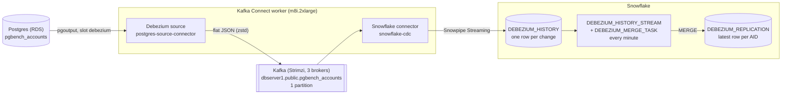
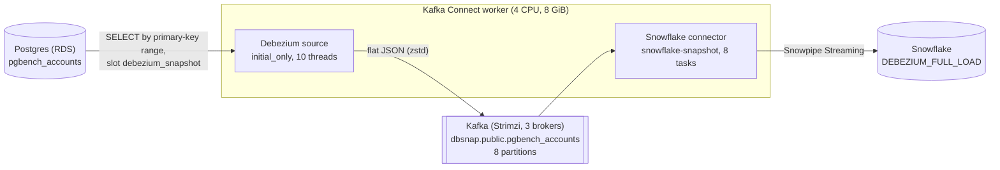

# Debezium + Kafka Connect into Snowflake

Snapshot time, replication latency and cost of the open-source path into Snowflake: Debezium reads Postgres, Kafka carries the changes, and the Snowflake connector writes them through Snowpipe Streaming. It runs the same 100M-row `pgbench_accounts` workload as the [Artie vs AWS DMS benchmark](../dms/README.md) and the [Snowflake Openflow benchmark](../openflow/README.md), so the results compare directly.

Continuous replication:



Snapshot (100M rows):



| Component | Version | Where |
| --- | --- | --- |
| Strimzi operator | 1.3.1 | [`k8s/Makefile`](../k8s/Makefile) |
| Kafka, Kafka Connect | 4.3.1 | [`kafka_cluster.yaml`](../k8s/strimzi/kafka_cluster.yaml), [`kafka_connect_snapshot.yaml`](../k8s/strimzi/kafka_connect_snapshot.yaml) |
| Debezium Postgres connector | 3.7.1.Final | built into the Connect image |
| Snowflake Kafka connector | 4.4.0 (Snowpipe Streaming only) | built into the Connect image |
| Bouncy Castle FIPS | bc-fips 2.1.2, bcutil-fips 2.1.8, bcpkix-fips 2.1.12 | built into the Connect image |

## Results

Run on 2026-11-23/24 with `TOOLS=debezium`. Raw data is in [`data/runs/2026-11-23-debezium`](../data/runs/2026-11-23-debezium). Artie and DMS ran the same workload on 2026-11-23 ([`data/runs/2026-11-23-artie-4cpu`](../data/runs/2026-11-23-artie-4cpu)). Latency is measured as in the [DMS benchmark](../dms/README.md#results): the commit time pgbench writes into `FILLER` against `METADATA$ROW_LAST_COMMIT_TIME` in Snowflake.

### Snapshot (100M rows, 3 rounds)

| | Time | CPU avg / peak | CPU-seconds |
| --- | --- | --- | --- |
| **Debezium** | 814.4, 745.7, 795.4 s (mean **785 s**) | Kafka Connect 5.0 / 5.7 vCPU, plus brokers 0.55 vCPU | about 3,900 + 430 |
| Artie | 358.6, 309.3, 309.5 s (mean 326 s) | 4.4 / 5.6 vCPU | about 1,435 |
| DMS | 618.3, 636.3, 636.3 s (mean 630 s) | 1.25 / 1.6 vCPU | about 790 |

Debezium ran at a steady 126,000–143,000 rows/s. The Snowflake connector kept up with Kafka, so Debezium reading Postgres and writing to Kafka set the pace. Each snapshot put about 1.25 GB on each broker (about 13 bytes per row after zstd).

### CDC (600 s of pgbench, 3 runs)

| | Load | History avg / p95 / p99 / max | Replication avg / p95 | History caught up after load |
| --- | --- | --- | --- | --- |
| **Debezium** | 19,700–21,900 tps | **6.0 / 9.7 / 11.1 / 13 s** | 33.2 / 42.8 s | 5–8 s |
| Artie | 17,200–19,000 tps | 8.0 / 11.5 / 15–54 / 62 s | 37.9 / 48.8 s | 32–61 s |
| DMS | 17,200–19,000 tps | 694 / 1,146–1,320 s | 1,364 s | 20–23 min |

Every change landed exactly once in every run. Debezium ran on its own, while Artie and DMS shared the source, so Debezium's runs carried 9–15% more changes. During the load, the Kafka Connect worker averaged 0.8 vCPU and 2.2 GiB. Artie's Reader and two Transfers averaged 1.5–1.7 vCPU. Debezium's slot held at most 412–663 MB of WAL, against Artie's 542–557 MB.

### Snowflake credits

Settled hourly metering from `ACCOUNT_USAGE`, in [`cost_settled.csv`](../data/runs/2026-11-23-debezium/cost_settled.csv):

| | CDC, 3 runs | Per CDC run | Per snapshot |
| --- | --- | --- | --- |
| **Debezium** | about 5.8 warehouse (merge task) + 0.08 Snowpipe Streaming = **about 5.9** | **about 1.97** | **about 0.21** (Snowpipe Streaming only) |
| Artie | about 7.3 | about 2.4 | about 1.1–1.3 |
| DMS | 15.9 | about 5.3 | — |

The meter shows 6.14 warehouse credits, but an interactive session (Snowsight, client `Go 2.4.0`) ran queries on the same warehouse before and between runs, adding about 0.3. The figure above excludes that. Most of Debezium's cost is the merge task. Each merge only takes 2–3 s, but it wakes the Large warehouse, which then runs out its 60 s auto-suspend. Snowpipe Streaming is billed per GB ingested, so it's cheap for both the snapshot and CDC. None of these numbers include compute on our side: Kafka Connect and the brokers for Debezium, and Reader, Transfer and Kafka for Artie.

A 100-update smoke test (`bench.sh cdc_smoke`) passed first: 13.1 s to history, 29.3 s to replication.

### Side by side with Artie (2026-11-24)

Artie and Debezium also ran **at the same time** from the same pgbench load, each CDC run starting on the hour. Debezium's merge task ran on its own warehouse (`BENCHMARK_WH_2`). Two Artie configurations were tested against unchanged Debezium:
- **Default:** `2026-11-24-artie-vs-debezium`, 2 runs.
- **Streaming:** `2026-11-24-artie-streaming-vs-debezium`, 2 runs. The only change is `streaming: true` on Artie's history Transfer: Snowpipe Streaming instead of COPY, with the default flush rules (30 s, 50 MB, 150,000 rows).

| Run | pgbench TPS | Artie history avg / p99 / max | Artie caught up | Artie replication avg | Debezium history avg / p99 / max | Debezium caught up | Debezium replication avg |
| --- | --- | --- | --- | --- | --- | --- | --- |
| Default 1 | 20,852 | 7.3 / 11.0 / 61.5 s | 59 s | 36.5 s | 5.9 / 11.1 / 13.4 s | 7 s | 30.3 s |
| Default 2 | 21,313 | 7.1 / 10.7 / 54.8 s | 54 s | 31.0 s | 6.0 / 11.3 / 13.2 s | 6 s | 33.1 s |
| Streaming 1 | 16,304 | 18.1 / 24.0 / 78.1 s | 75 s | 22.9 s | 5.9 / 11.2 / 13.8 s | 6 s | 34.0 s |
| Streaming 2 | 16,419 | 12.6 / 20.0 / 73.1 s | 72 s | 29.4 s | 5.9 / 11.1 / 13.1 s | 6 s | 34.0 s |

- **History:** Debezium is about 1.2–1.4 s faster than default Artie on average, and they match at p99. Artie's last changes land 55–60 s after the load stops; Debezium's land within 6–7 s.
- **Replication:** about the same for both, set by each tool's merge cadence.
- **Artie with streaming was slower.** Transfer still fills its buffer before each flush, then waits for Snowflake to commit the streamed batch. The Snowflake connector appends continuously without waiting.
- **pgbench ran about 23% slower in both streaming runs** (16.3–16.4k against 20.8–21.3k TPS). The cause isn't known yet, so the streaming runs aren't directly comparable with the default ones.
- **Cost:** 2.01 credits per run for Debezium (warehouse plus 0.021–0.027 of Snowpipe Streaming) against 2.51–2.56 for Artie, from settled metering. Streaming didn't lower Artie's warehouse credits, because its replication Transfer still merges on the warehouse.

An earlier 08:00 streaming attempt also changed the flush rules by mistake and is excluded (`cdc-aborted-small-flush/`). Default run 1's 15-second samples were lost; see its `README.txt`.

## How it differs from Artie and DMS

- **Every row goes through Kafka, including the snapshot.** Artie's snapshot writes straight to Snowflake and DMS goes through S3. So Kafka is part of what's measured, and the brokers' CPU is recorded with Debezium's.
- **The Snowflake connector only appends.** It writes one row per change to `DEBEZIUM_HISTORY`. Applying updates and deletes takes a separate MERGE task, as with DMS. Artie maintains the replication table itself.
- **Billing.** The Snowflake connector is billed per uncompressed GB ingested (Snowpipe Streaming), not by warehouse time. Only the merge task uses a warehouse.
- **Columns.** Debezium's `ExtractNewRecordState` transform flattens each change event to the row, plus `__op`, `__lsn` and `__source_ts_ms`. With schematization on, the Snowflake connector writes each field to its own column. Older setups landed everything in `RECORD_CONTENT`/`RECORD_METADATA` and needed a job to unpack it.

## Prerequisites

- The infrastructure from the [top-level README](../README.md#prerequisites): RDS with `pgbench_accounts` loaded (100M rows), in a VPC the EKS cluster can reach.
- An EKS cluster with:
  - 3 × m5.xlarge for Kafka, labelled and tainted `workload=kafka` (NoSchedule).
  - 1 × m8i.2xlarge for Kafka Connect, labelled `workload=kafka-connect`.
  - A `gp3` storage class.
- A Docker Hub account with push access to the repository in `spec.build.output.image`. Strimzi builds the Connect image and pushes it there.
- A Snowflake user with key-pair authentication, and a role that can create tables, pipes, streams and tasks in the benchmark schema.

<details>

<summary>Setup (Kafka)</summary>

From [`k8s/`](../k8s), with `KUBE_CONTEXT` set to your cluster:

```bash
make strimzi_operator    # Strimzi 1.3.1, watching the kafka namespace
make kafka_secret        # random SCRAM password for the artie Kafka user
make kafka               # Kafka 4.3.1: KafkaUser, cluster, broker and controller node pools, exporter service
```

The brokers and controllers tolerate the `workload=kafka` taint, prefer those nodes, and spread one of each per node. Retention is 24 hours. There's only an internal SCRAM listener on 9093.

Check the cluster is ready:

```bash
kubectl -n kafka get kafka artie-kafka
kubectl -n kafka get pods -o wide
```

</details>

<details>

<summary>Setup (Kafka Connect)</summary>

### 1. Secrets

Copy [`postgres-credentials.example.yaml`](../k8s/secrets/postgres-credentials.example.yaml) and [`snowflake-credentials.example.yaml`](../k8s/secrets/snowflake-credentials.example.yaml) to the same names without `.example`, and fill them in. They're gitignored.

- `postgres.properties`:
  - `hostname`: `terraform -chdir=aws/dms/tf output rds_endpoint`, without the port.
  - `username`: `dbuser`.
  - `password`: `db_password` in `terraform.tfvars`.
- `snowflake.properties`:
  - `account` and `region`: these form the URL, `<account>.<region>.snowflakecomputing.com`.
  - `username` and `role`.
  - `database` and `schema`: the benchmark schema.
  - `private_key`: the base64 body of the PKCS#8 key, without header lines. `private_key_passphrase` can be empty for an unencrypted key.
  - `warehouse` isn't used. Snowpipe Streaming doesn't run on a warehouse.

Create the registry secret Strimzi pushes the image with, then apply the two secrets:

```bash
kubectl -n kafka create secret docker-registry dockerhub-credentials \
  --docker-server=docker.io --docker-username=<user> --docker-password=<token>
make kafka_connector_secrets
```

### 2. Build and start the worker

```bash
make kafka_connect       # applies strimzi/kafka_connect_snapshot.yaml
```

Strimzi runs a build pod (`connect-connect-build`) that:
1. Downloads the connector jars and checks each against its `sha512sum`.
2. Builds the image on top of Strimzi's Kafka Connect 4.3.1.
3. Pushes it to `spec.build.output.image`.

Then it starts `connect-connect-0` from that image. The first build takes about a minute. Strimzi rebuilds only when `spec.build` changes. Resizing the worker just restarts the pod.

The worker is sized for the snapshot: 4 CPUs requested with no CPU limit, 8 GiB, and a 4 GB heap. That's the same CPU request as the Artie snapshot pod. `bench.sh` drops it to 1 CPU, 3 GiB and a 1.5 GB heap for CDC runs.

Check it's ready and both plugins are loaded:

```bash
kubectl -n kafka get kafkaconnect connect
kubectl -n kafka exec connect-connect-0 -- curl -s localhost:8083/connector-plugins | jq -r '.[].class'
```

### Settings that matter

These are all in [`kafka_connect_snapshot.yaml`](../k8s/strimzi/kafka_connect_snapshot.yaml). Each one fixed a failure.

- **`spec.build.output.image` includes the registry** (`docker.io/...`). Strimzi 1.x builds with Buildah, which treats an image without a registry as `localhost/...`. The pod then can't pull it.
- **`template.pod.tmpDirSizeLimit: 256Mi`.** Strimzi's default for `/tmp` is 5 MiB. When their tasks start, the connectors unpack native libraries into `/tmp`: the Snowpipe Streaming SDK (29 MB), the Snowflake JDBC driver's (about 5 MB) and Kafka's zstd (1 MB). With 5 MiB, both tasks fail with "No space left on device". `/tmp` is held in memory and counts toward the pod's memory limit.
- **`value.converter.schemas.enable: false`.** With schemas on, every message carries its full schema. That's about 4× the bytes, and the 100M-row snapshot wouldn't fit on the brokers' disks.
- **`producer.compression.type: zstd`.** `FILLER` is padded to 84 characters, so the snapshot compresses well.

</details>

<details>

<summary>Setup (Snowflake)</summary>

Create the tables before starting any connector. If the Snowflake connector creates a table itself, it infers each column's type from the first row. It typed `FILLER` (pgbench's commit time as text, with a `+00` offset) as `TIMESTAMP_NTZ`, which dropped the offset and broke the latency queries.

```sql
ALTER SCHEMA <db>.<schema> SET ROW_TIMESTAMP_DEFAULT = TRUE;

CREATE TABLE DEBEZIUM_FULL_LOAD (
  AID NUMBER NOT NULL,
  BID NUMBER,
  ABALANCE NUMBER,
  FILLER VARCHAR,
  __OP VARCHAR,
  __LSN NUMBER,
  __SOURCE_TS_MS NUMBER,
  __DELETED VARCHAR,
  RECORD_METADATA VARIANT
) ROW_TIMESTAMP = TRUE;

CREATE TABLE DEBEZIUM_HISTORY (
  AID NUMBER NOT NULL,
  BID NUMBER,
  ABALANCE NUMBER,
  FILLER VARCHAR,
  __OP VARCHAR,
  __LSN NUMBER,
  __SOURCE_TS_MS NUMBER,
  __DELETED VARCHAR,
  RECORD_METADATA VARIANT
) ROW_TIMESTAMP = TRUE;

CREATE TABLE DEBEZIUM_REPLICATION (
  AID INT NOT NULL,
  BID INT,
  ABALANCE INT,
  FILLER VARCHAR,
  __OP VARCHAR,
  __LSN NUMBER,
  __SOURCE_TS_MS NUMBER
) ROW_TIMESTAMP = TRUE;
```

`bench.sh sf_setup` runs this, from [`setup.sql`](../run/sql/setup.sql) and [`setup_debezium.sql`](../run/sql/setup_debezium.sql). The connector maps fields to columns by name (`aid` → `AID`). It puts the Kafka key, topic, partition and offset in `RECORD_METADATA`.

The connector creates its own Snowpipe Streaming pipe per table, named `<TABLE>-STREAMING`. It needs a role that can create pipes in the schema and insert into the tables.

</details>

<details>

<summary>Snapshot (Postgres -> Debezium -> Kafka -> Snowflake)</summary>

`bench.sh snapshot_debezium N` runs one round. It takes the two connectors in [`kafka_connect_cdc.yaml`](../k8s/strimzi/kafka_connect_cdc.yaml) and changes these settings:

| Connector | Changed for the snapshot |
| --- | --- |
| Debezium source | New name each run. `snapshot.mode: initial_only` (snapshot the table, then stop). `snapshot.max.threads: 10`, which splits the table by primary-key range; Debezium marks this as incubating. `max.batch.size: 10240`, `max.queue.size: 40960`. Slot `debezium_snapshot`, topic prefix `dbsnap`. No automatic restart, because a restarted snapshot would load the table twice. |
| Snowflake sink | Named `snowflake-snapshot`. 8 tasks, one per partition of the topic `dbsnap.public.pgbench_accounts`, writing to `DEBEZIUM_FULL_LOAD`. |

Each round:

1. Deletes any Debezium connectors, drops idle slots, and resizes the worker to 4 CPU and 8 GiB.
2. Creates the 8-partition topic if it doesn't exist and empties it. Truncates `DEBEZIUM_FULL_LOAD`.
3. Starts the sink, then the source. The clock starts with the source.
4. Samples `kubectl top` every 15 s until `DEBEZIUM_FULL_LOAD` has 100M rows, then waits 60 s.
5. Records:
   - the time to the last Snowflake commit;
   - Debezium's own finish time, from its "Snapshot ended" log line;
   - CPU for the Connect pod (`debezium`) and the three brokers summed (`debezium_kafka`).
6. Deletes the connectors, drops the slot and empties the topic.

To time it by hand, use the same query as for DMS:

```sql
SELECT COUNT(*), MAX(METADATA$ROW_LAST_COMMIT_TIME) FROM DEBEZIUM_FULL_LOAD;
```

</details>

<details>

<summary>Continuous Replication (Postgres -> Debezium -> Kafka -> Snowflake)</summary>

### 1. Connectors

[`kafka_connect_cdc.yaml`](../k8s/strimzi/kafka_connect_cdc.yaml) has the two connectors:

- **`postgres-source-connector`** (Debezium):
  - `snapshot.mode: no_data`: start streaming from when the slot is created, with no snapshot first.
  - Slot `debezium`, `pgoutput`, and the existing `dbz_publication`, with `publication.autocreate.mode: disabled`.
  - `ExtractNewRecordState`, with `add.fields: op,lsn,source.ts_ms` and `delete.tombstone.handling.mode: rewrite`. A delete becomes a row with `__op = d` and `__deleted = true`.
- **`snowflake-cdc`** (Snowflake connector, `SnowflakeStreamingSinkConnector`):
  - One task, reading `dbserver1.public.pgbench_accounts` into `DEBEZIUM_HISTORY`.
  - `snowflake.enable.schematization: true` and `snowflake.compatibility.enable.column.identifier.normalization: true`, so each field gets its own upper-case column.

To run CDC by hand:

```bash
make kafka_connect_cdc
kubectl -n kafka exec connect-connect-0 -- curl -s localhost:8083/connectors?expand=status | jq
```

`bench.sh cdc_run N` applies the same two connectors, giving the source a new name each run so it starts without stored offsets. It first deletes any connector applied by hand, because that would hold the `debezium` slot.

### 2. Merge into the replication table

Once `DEBEZIUM_HISTORY` exists, create a stream and a merge task. This is [`debezium_cdc_start.sql`](../run/sql/debezium_cdc_start.sql):

```sql
CREATE OR REPLACE STREAM DEBEZIUM_HISTORY_STREAM ON TABLE DEBEZIUM_HISTORY APPEND_ONLY = TRUE;

CREATE OR REPLACE TASK DEBEZIUM_MERGE_TASK
  WAREHOUSE = <warehouse>
  SCHEDULE = '1 minute'
WHEN
  SYSTEM$STREAM_HAS_DATA('DEBEZIUM_HISTORY_STREAM')
AS
  MERGE INTO DEBEZIUM_REPLICATION AS t
  USING (
    SELECT * FROM DEBEZIUM_HISTORY_STREAM
    QUALIFY ROW_NUMBER() OVER (PARTITION BY AID ORDER BY __LSN DESC) = 1
  ) AS s
    ON t.AID = s.AID
  WHEN MATCHED AND s.__OP = 'd' THEN DELETE
  WHEN MATCHED THEN
    UPDATE SET
      t.BID = s.BID,
      t.ABALANCE = s.ABALANCE,
      t.FILLER = s.FILLER,
      t.__OP = s.__OP,
      t.__LSN = s.__LSN,
      t.__SOURCE_TS_MS = s.__SOURCE_TS_MS
  WHEN NOT MATCHED AND s.__OP <> 'd' THEN
    INSERT (AID, BID, ABALANCE, FILLER, __OP, __LSN, __SOURCE_TS_MS)
    VALUES (s.AID, s.BID, s.ABALANCE, s.FILLER, s.__OP, s.__LSN, s.__SOURCE_TS_MS);

ALTER TASK DEBEZIUM_MERGE_TASK RESUME;
```

It's the same shape as the DMS merge task. The one difference is that it keeps the latest change per account by the source LSN rather than by `FILLER`. Before each CDC run, `bench.sh` reseeds `DEBEZIUM_REPLICATION` from `DEBEZIUM_FULL_LOAD` ([`debezium_cdc_reset.sql`](../run/sql/debezium_cdc_reset.sql)), so the merge runs against a 100M-row table, as it does for Artie and DMS.

### 3. Monitor

```bash
# connector and task state
kubectl -n kafka exec connect-connect-0 -- curl -s localhost:8083/connectors/snowflake-cdc/status | jq
# Kafka consumer lag of the sink (group connect-snowflake-cdc), from the Kafka exporter
kubectl get --raw /api/v1/namespaces/kafka/services/kafka-exporter-service:80/proxy/metrics | grep 'consumergroup="connect-snowflake-cdc"'
```

```sql
SELECT COUNT(*), MAX(METADATA$ROW_LAST_COMMIT_TIME) FROM DEBEZIUM_HISTORY;
SELECT * FROM TABLE(INFORMATION_SCHEMA.TASK_HISTORY(TASK_NAME => 'DEBEZIUM_MERGE_TASK')) ORDER BY SCHEDULED_TIME DESC;
```

### 4. Generate load and measure

`bench.sh cdc` does this: 3 runs of pgbench (`custom_tpcb.sql`, 50 clients, 8 threads, 600 s), each followed by catch-up and measurement. The latency queries are the ones in the [DMS benchmark's Results](../dms/README.md#results), run against `DEBEZIUM_HISTORY` and `DEBEZIUM_REPLICATION`.

The Snowflake connector's credits are in `SNOWFLAKE.ACCOUNT_USAGE.METERING_HISTORY` under `SERVICE_TYPE = 'SNOWPIPE_STREAMING'` ([`cost.sql`](../run/sql/cost.sql) reads both). The merge task's credits are in the warehouse metering.

</details>

<details>

<summary>Running it with bench.sh</summary>

[`run/bench.sh`](../run/bench.sh) runs everything above. With `TOOLS=debezium` (the default) in `run/.env`, it runs Debezium by itself, and the merge task uses `BENCHMARK_WH`:

```bash
./run/bench.sh check          # also checks Kafka Connect, both plugins, the connector file and the secrets
./run/bench.sh pg_pod
./run/bench.sh sf_setup       # drops and recreates the benchmark schema
./run/bench.sh cdc_smoke      # 100 updates, checked row for row in history and replication
./run/bench.sh snapshots      # SNAPSHOT_RUNS × (VACUUM FULL, Debezium snapshot)
./run/bench.sh cdc            # CDC_RUNS × (reset, start, pgbench, catch-up, measure)
./run/bench.sh cost           # rerun a few hours later; metering lags
```

See [`run/README.md`](../run/README.md) for every step and output file.

**Kafka topics are emptied between runs, not deleted.** The Snowflake connector skips any offset at or below the last one it committed for a channel. A recreated topic restarts its offsets at 0, so its rows would be skipped as duplicates. `bench.sh` uses `kafka-delete-records` instead, which keeps the offsets increasing.

</details>

<details>

<summary>Schema evolution</summary>

`pgbench_accounts` doesn't change during the benchmark, but for a real table:

| Layer | Add a column | Drop a column | Rename or change a type |
| --- | --- | --- | --- |
| Postgres publication (`FOR TABLE`) | Nothing to do | Nothing to do | Nothing to do |
| Debezium | Nothing to do: pgoutput announces the new column | Nothing to do: the field disappears | Nothing to do |
| Kafka (JSON, no schema registry) | Nothing to do | Nothing to do | Nothing to do |
| Snowflake connector | Added automatically only if the table has `ENABLE_SCHEMA_EVOLUTION = TRUE` and the connector's role owns it. The type is inferred from the first value, so add the column yourself when the type matters. | The column stays; new rows have NULL | Manual. A rename appears as a new column; a type change isn't handled. |
| Merge task and `DEBEZIUM_REPLICATION` | Manual: add the column to the table and to the MERGE | Optional | Manual |

The tables in Setup (Snowflake) don't set `ENABLE_SCHEMA_EVOLUTION`, because the benchmark doesn't need it.

New tables also need entries in `table.include.list`, the publication and `snowflake.topic2table.map`, plus their own merge task.

</details>

## Teardown

```bash
./run/bench.sh teardown                  # deletes the connectors, suspends the merge task, drops idle slots
kubectl -n kafka delete kafkaconnect connect
```

Then scale down or remove the `workload=kafka-connect` and `workload=kafka` node groups in the EKS Terraform. For RDS and the rest, see [Teardown](../README.md#teardown) in the top-level README.
