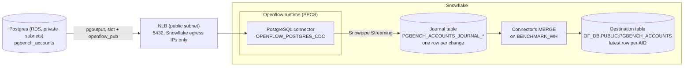

# Snowflake Openflow into Snowflake

Snapshot time, replication latency and cost of Snowflake's own CDC path. The Openflow Connector for PostgreSQL runs on an Openflow runtime inside Snowflake (Snowpark Container Services). It reads Postgres through a replication slot and writes through Snowpipe Streaming into a journal table, then MERGEs the journal into the destination table on a warehouse. It runs the same 100M-row `pgbench_accounts` workload as the [Artie vs AWS DMS benchmark](../dms/README.md) and the [Debezium + Kafka Connect benchmark](../kafka-connect/README.md), so the results compare directly.

Continuous replication:



Snapshot (100M rows): the connector reads the table with keyset-paged `SELECT`s, 100,000 rows at a time and one query at a time, and streams them straight into the destination table. Then it switches to the slot for CDC.

| Component | Version | Where |
| --- | --- | --- |
| Openflow deployment | Snowflake deployment (SPCS), gen 2 | `CREATE OPENFLOW DEPLOYMENT`, below |
| Openflow runtime | 1 MEDIUM node (min 1, max 1), runtime service version 2026.11.20.20 | `CREATE OPENFLOW RUNTIME`, below |
| PostgreSQL connector | `OPENFLOW_POSTGRES_CDC` 1.0.0, PostgreSQL JDBC driver 42.7.15 | `SHOW OPENFLOW CONNECTOR DEFINITIONS` |
| Connector settings | | `openflow/config.json`, downloaded from the connector (Setup (Connector) step 2). [`config.json.example`](config.json.example) is the one used here, with placeholders |
| NLB in front of RDS | | [`aws/dms/tf/openflow.tf`](../aws/dms/tf/openflow.tf) |

## Results

Run `2026-11-25-openflow`, on 2026-11-25, with Openflow on its own. All times are UTC. Results are in `data/runs/2026-11-25-openflow/`, in the same format as the other tools (see [`run/README.md`](../run/README.md#4-results)).

- **Snapshot (100M rows):** 1,331 s (22.2 min) on average, against Debezium's 785 s and Artie's 326 s. The connector reads one 100,000-row page at a time.
- **CDC history:** 13.8 s average latency (p99 about 21 s), about twice Debezium's 6.0 s and Artie's 7–8 s. Every change landed exactly once.
- **CDC replication:** 54.0 s average, against 30–38 s for Debezium and Artie. Its merges take 7–9 s each, against 3 s for Debezium's merge task.
- **Cost:** about 2.2 warehouse credits per CDC run for the merges, plus the runtime and control pools (about 0.4 credits an hour whenever the deployment exists) and 0.02 of Snowpipe Streaming. First pass only; see Snowflake cost below.

### Snapshot (100M rows)

| Run | Time | Notes |
| --- | --- | --- |
| Trial | 1,403.3 s (23.4 min) | Without `VACUUM FULL` first; first rows 80 s after `START` |
| 1 | 1,589.6 s (26.5 min) | |
| 2 | 1,147.1 s (19.1 min) | |
| 3 | 1,256.3 s (20.9 min) | |
| **Mean of 1–3** | **1,331.0 s (22.2 min)** | Each round loaded exactly 100M rows |

For comparison, Debezium took 785 s on average and Artie 326 s, so Openflow was 1.7× slower than Debezium and 4.1× slower than Artie. Times include the 40–80 s between `START` and the first rows. The connector reads one 100,000-row page at a time; "Concurrent Snapshot Queries" only runs several tables at once, so it doesn't help a single table. It loaded 65–85k rows/s, against Debezium's 126–143k. The snapshot used no warehouse: rows arrive through Snowpipe Streaming.

### CDC latency (600 s load)

|                                         | Run 1 (13:00)               | Run 2 (14:00)               | Run 3 (15:00)               | Mean           |
| --------------------------------------- | --------------------------- | --------------------------- | --------------------------- | -------------- |
| pgbench TPS                             | 21,793                      | 21,747                      | 22,250                      | 21,930         |
| Transactions                            | 13,067,331                  | 13,039,839                  | 13,341,523                  |                |
| **History** avg / p95 / p99 / max       | 13.7 / 18.9 / 20.8 / 22.7 s | 13.6 / 18.8 / 20.7 / 23.2 s | 14.2 / 19.7 / 21.3 / 23.2 s | **13.8 s** avg |
| History caught up after load            | 11.8 s                      | 14.4 s                      | 9.0 s                       | 11.7 s         |
| **Replication** avg / p95 / p99 / max   | 57.7 / 66.6 / 73.8 / 88.5 s | 54.1 / 63.1 / 70.1 / 80.2 s | 50.2 / 59.0 / 65.5 / 72.0 s | **54.0 s** avg |
| Replication caught up after load        | 54.0 s                      | 50.3 s                      | 46.4 s                      | 50.2 s         |
| Merges on BENCHMARKWH (count, avg, max) | 11, 8.9 s, 13.7 s           | 12, 8.0 s, 9.6 s            | 13, 7.1 s, 8.1 s            |                |
| Peak WAL held by the slot               | 505 MB                      | 523 MB                      | 495 MB                      |                |

- Every run's journal had exactly one row per transaction plus the warm-up row.
- History latency stays between about 6 s and 23 s, with p50 close to the average: the journal fills at an even pace rather than in bursts.
- Replication is the journal latency plus the merge: a 1-minute schedule, then a MERGE of 7–9 s into the 100M-row table. Debezium's merge task ran the same schedule with 3-second merges.
- For comparison (from the [Debezium page](../kafka-connect/README.md)): Debezium on its own averaged 6.0 s history and 33.2 s replication; Artie 7–8 s and 31–38 s.

### Snowflake cost

First pass, read at 15:20, before teardown; hours from 12:00 on may still change, and the 15:00 compute-pool rows hadn't arrived. A second pass after 19:15 will replace these.

| Part                                        | Per CDC run                | Notes                                         |
| ------------------------------------------- | -------------------------- | --------------------------------------------- |
| Merges on BENCHMARKWH                       | 2.19–2.20 credits          | 11–13 merges, each waking the Large warehouse |
| Snowpipe Streaming into the journal         | 0.019 credits              | About 5.4 GB per run                          |
| Runtime pool (`OPENFLOW_COMPUTE_SNOWFLAKE`) | 0.30–0.53 credits per hour | Runs whenever the runtime exists, busy or not |
| Control pool                                | 0.08–0.14 credits per hour | Runs whenever the deployment exists           |

Per 100M-row snapshot: about 0.095–0.13 credits of Snowpipe Streaming (27.7 GB) and no warehouse, plus the pools for its 20–27 minutes. Debezium's snapshot cost about 0.21 credits of Snowpipe Streaming.

### CDC smoke test

100 single-row updates, each its own transaction: every one landed exactly once in the journal and in the destination.

| Mode | Rows | Avg | p99 | Caught up |
| --- | --- | --- | --- | --- |
| History (journal) | 100 | 12.5 s | 12.6 s | 13.3 s |
| Replication (destination) | 100 | 33.4 s | 33.4 s | 34.1 s |

### Setup time

From an empty account to a running snapshot took about an hour, much of it on the problems in the [setup log](#setup-log-2026-11-25) below. Without them:

| Step | Took |
| --- | --- |
| `CREATE OPENFLOW DEPLOYMENT` until `ACTIVE` | 14 min |
| `CREATE OPENFLOW RUNTIME` until `ACTIVE` | 3.5 min |
| `CREATE OPENFLOW CONNECTOR` until `STOPPED`, then commit until `STOPPED` again | about 2 min |
| `START` until the first snapshot rows | 80 s |
| `TERMINATE` until `TERMINATED` (each snapshot round) | about 2.5 min |

## How it differs from Artie, DMS and Debezium

- **It runs inside Snowflake.** The runtime is a Snowflake deployment on SPCS, not in the benchmark VPC. BYOC (runtime in our AWS account) needs the organization administrator to accept the BYOC terms, which this account can't do, so it isn't used.
- **It reaches Postgres over the internet.** SPCS can't reach the private RDS, so an internet-facing NLB forwards 5432 to RDS's private IP, and only Snowflake's egress CIDRs may connect. The others connect inside the VPC. RDS and the region (`us-west-2`) are the same for all tools.
- **It maintains the replication table itself,** like Artie and unlike DMS and Debezium, which need a separate merge task. Its merges run every minute (the default schedule), the same as the DMS and Debezium merge tasks. Deletes are soft: the destination keeps the row with `_SNOWFLAKE_DELETED = TRUE`.
- **It snapshots one page at a time.** Artie and Debezium read 10 primary-key ranges in parallel. Openflow has no setting for that on a single table.
- **Billing.** Three parts: the runtime's compute pools (credits, no cloud bill), Snowpipe Streaming into the journal (per GB ingested), and the merge warehouse.
- **No** `kubectl top`**.** Runtime CPU isn't sampled the way the Artie pods and Kafka Connect are. The runtime's node type and count are recorded instead.
- **It writes to its own database.** See Setup (Snowflake) step 7.

## Prerequisites

- The infrastructure from the [top-level README](../README.md#prerequisites): RDS with `pgbench_accounts` loaded (100M rows).
- A role that can create Openflow deployments (`ACCOUNTADMIN` here), warehouses, network rules, external access integrations, secrets and roles.
- The Snowflake CLI with a connection (`SNOW_CONNECTION` in `run/.env`). Every Snowflake step below is SQL, run with `snow sql`, except checking connector status, which is in the Openflow UI.
- **Openflow objects don't go in the benchmark schema.** `bench.sh sf_setup` drops and recreates `<SF_DB>.<SF_SCHEMA>`. The deployment, runtime, connector and secret live in `<SF_DB>.OPENFLOW`, and the connector's destination and journal tables in `<OF_DB>.PUBLIC`.
- The PostgreSQL JDBC driver jar, `postgresql-42.7.15.jar` from Maven Central, at the path in `OF_DRIVER` (`openflow/driver/` is gitignored).


Setup (Network)

## Setup (Network)

RDS stays in the private subnets. [`aws/dms/tf/openflow.tf`](../aws/dms/tf/openflow.tf) adds an internet-facing NLB in the public subnet that forwards 5432 to RDS's private IP. It's off by default.

1. Get the account's egress ranges in Snowflake:
   ```sql
    SELECT SYSTEM$GET_SNOWFLAKE_EGRESS_IP_RANGES();
   ```
2. Add them to [terraform.tfvars](../aws/dms/tf/terraform.tfvars), with `openflow_public_access` on:
   ```hcl
    openflow_public_access = true
    snowflake_egress_cidrs = ["<range 1>", "<range 2>"]
   ```

    The ranges have an expiry date, which the function returns with them. Check it before each round of runs.
3. Apply. It adds 5 resources (the NLB, its listener, target group, target attachment and security group) and changes nothing else.
   ```bash
    terraform -chdir=aws/dms/tf apply
    terraform -chdir=aws/dms/tf output -raw openflow_pg_host
   ```

    `openflow_pg_host` is the hostname for the JDBC URL and the network rule.

Notes:

- The NLB's security group allows 5432 in from the egress ranges only, and 5432 out to RDS's IP only. RDS sees the NLB's private IP, which `rds_sg` already allows.
- The NLB targets RDS's private IP, which Terraform looks up from its network interface. A single-AZ instance keeps its IP across reboots. If RDS is replaced or restored, apply again.
- RDS's certificate is for the RDS hostname, not the NLB's, so connect with `sslmode=require`, not `verify-full`.


Setup (Postgres)

## Setup (Postgres)

Openflow gets its own publication, so dropping one tool's publication never breaks another's. From the `pgbench` pod (`bench.sh pg_pod`):

```sql
CREATE PUBLICATION openflow_pub FOR TABLE public.pgbench_accounts;
```

`pgbench -i` drops and recreates the tables, which empties every publication. Recreate `openflow_pub` after `bench.sh pg_init`, as `pg_init` does for `dbz_publication`.

The connector creates its own replication slot when it starts. `wal_level` is already `logical` (`rds.logical_replication = 1`). The source user is `dbuser`, which has `rds_replication`. `pgbench_accounts` has a primary key on `aid`, which the connector uses as the replication key.

Openflow's slot holds WAL whenever the connector is stopped. Drop it when you aren't running Openflow, especially during another tool's CDC runs.


Setup (Snowflake)

## Setup (Snowflake)

Run as `ACCOUNTADMIN`. `<SF_DB>` and `<SF_SCHEMA>` are `SF_DB` and `SF_SCHEMA` in `run/.env`.

### 1. Schema for the Openflow objects

```sql
CREATE SCHEMA IF NOT EXISTS <SF_DB>.OPENFLOW;
```

### 2. Network rule and external access integration

```sql
CREATE NETWORK RULE <SF_DB>.OPENFLOW.OPENFLOW_PG_RULE
  MODE = EGRESS
  TYPE = HOST_PORT
  VALUE_LIST = ('<openflow_pg_host>:5432');

CREATE EXTERNAL ACCESS INTEGRATION OPENFLOW_PG_EAI
  ALLOWED_NETWORK_RULES = (<SF_DB>.OPENFLOW.OPENFLOW_PG_RULE)
  ENABLED = TRUE;
```

### 3. Roles

`OPENFLOW_ADMIN` owns the deployment, runtime and connector. `OPENFLOW_RUNTIME_RL` is the runtime's execute-as role: everything the connector does in Snowflake runs as it.

```sql
CREATE ROLE IF NOT EXISTS OPENFLOW_ADMIN;
GRANT CREATE OPENFLOW DEPLOYMENT ON ACCOUNT TO ROLE OPENFLOW_ADMIN;
GRANT CREATE COMPUTE POOL ON ACCOUNT TO ROLE OPENFLOW_ADMIN;   -- the deployment creates its own pools
GRANT USAGE ON DATABASE <SF_DB> TO ROLE OPENFLOW_ADMIN;
GRANT USAGE ON SCHEMA <SF_DB>.OPENFLOW TO ROLE OPENFLOW_ADMIN;
GRANT CREATE OPENFLOW RUNTIME, CREATE OPENFLOW CONNECTOR ON SCHEMA <SF_DB>.OPENFLOW TO ROLE OPENFLOW_ADMIN;
GRANT USAGE ON INTEGRATION OPENFLOW_PG_EAI TO ROLE OPENFLOW_ADMIN;
GRANT ROLE OPENFLOW_ADMIN TO ROLE ACCOUNTADMIN;

CREATE ROLE IF NOT EXISTS OPENFLOW_RUNTIME_RL;
GRANT USAGE ON INTEGRATION OPENFLOW_PG_EAI TO ROLE OPENFLOW_RUNTIME_RL;
GRANT USAGE, OPERATE ON WAREHOUSE BENCHMARK_WH TO ROLE OPENFLOW_RUNTIME_RL;
GRANT USAGE ON DATABASE <SF_DB> TO ROLE OPENFLOW_RUNTIME_RL;
GRANT USAGE ON SCHEMA <SF_DB>.OPENFLOW TO ROLE OPENFLOW_RUNTIME_RL;
GRANT ROLE OPENFLOW_RUNTIME_RL TO ROLE OPENFLOW_ADMIN;
```

The grants on `<SF_SCHEMA>` are separate (step 7), because `sf_setup` drops the schema and its grants with it.

### 4. Warehouse

The connector's merges run on `BENCHMARK_WH` (`OF_WH` in `run/.env`): Large, 60 s auto-suspend, the same warehouse and settings Artie and the Debezium-only runs used. Openflow runs on its own (`TOOLS=openflow`), so its credits are its own. Start each CDC run on the hour, as for the other tools, so each run's credits fall in its own metering hour, and don't use the warehouse for anything else during the runs: an interactive Snowsight session on it once added about 0.3 credits to the Debezium runs.

To run Openflow at the same time as Artie, give it a warehouse of its own, as Debezium got `BENCHMARK_WH_2` for its side-by-side runs. `bench.sh check` refuses two tools in one run on the same warehouse.

`BENCHMARK_WH` has query acceleration on (max scale factor 2). Record it in the results.

### 5. Deployment and runtime

```sql
USE ROLE OPENFLOW_ADMIN;

CREATE OPENFLOW DEPLOYMENT BENCHMARK_OPENFLOW
  DEPLOYMENT_TYPE = SNOWFLAKE
  DISPLAY_NAME = 'Benchmark';

-- Returns at once, but the deployment stays PROVISIONING for about 15 minutes (14 min on 2026-11-25), and a runtime
-- can't be created until SHOW OPENFLOW DEPLOYMENTS shows it ACTIVE.

CREATE OPENFLOW RUNTIME <SF_DB>.OPENFLOW.BENCHMARK_RT
  IN DEPLOYMENT BENCHMARK_OPENFLOW
  NODE_TYPE = MEDIUM
  MIN_NODES = 1
  MAX_NODES = 1
  EXECUTE_AS_ROLE = OPENFLOW_RUNTIME_RL
  EXTERNAL_ACCESS_INTEGRATIONS = (OPENFLOW_PG_EAI)
  DISPLAY_NAME = 'Benchmark';
```

One node, fixed, so every run has the same compute. The `OPENFLOW_POSTGRES_CDC` definition reports `max_node_count = 1`, so more nodes wouldn't help. Record the node type's vCPUs and memory in the results.

### 6. Postgres password

```sql
CREATE SECRET <SF_DB>.OPENFLOW.PG_PASSWORD
  TYPE = GENERIC_STRING
  SECRET_STRING = '<db_password from terraform.tfvars>';
GRANT READ ON SECRET <SF_DB>.OPENFLOW.PG_PASSWORD TO ROLE OPENFLOW_RUNTIME_RL;
```

### 7. Destination database

The connector's "Destination Schema Strategy" names the destination schema after the source schema (`SOURCE_SCHEMA`, so `PUBLIC`), and can't be changed after the first apply. The docs don't list its other values. So the connector writes into a database of its own, `<OF_DB>` (`OF_DB` in `run/.env`), whose `PUBLIC` schema holds nothing else. That also keeps its tables out of `sf_setup`, which drops `<SF_DB>.<SF_SCHEMA>`.

```sql
CREATE DATABASE IF NOT EXISTS <OF_DB>;
ALTER SCHEMA <OF_DB>.PUBLIC SET ROW_TIMESTAMP_DEFAULT = TRUE;   -- before the connector creates any table
GRANT USAGE ON DATABASE <OF_DB> TO ROLE OPENFLOW_RUNTIME_RL;
GRANT USAGE, CREATE TABLE, CREATE STREAM, CREATE TASK, CREATE VIEW ON SCHEMA <OF_DB>.PUBLIC TO ROLE OPENFLOW_RUNTIME_RL;
```

`CREATE TABLE` covers the snapshot. The first change after the snapshot needs `CREATE STREAM` as well: without it the connector creates the journal table, fails 101 `CREATE STREAM` attempts in 10 seconds, and doesn't merge.

The tables the connector created had `METADATA$ROW_LAST_COMMIT_TIME` on every row, and `FILLER` landed as `TEXT`.


Setup (Connector)

## Setup (Connector)

Gen 2 connectors are SQL objects. Their settings are in a `config.json` on the connector's versioned stage, which you `GET`, edit, `PUT` and commit. The Openflow UI isn't needed, except to see the connector's status.

### 1. Create it

```sql
USE ROLE OPENFLOW_ADMIN;

CREATE OPENFLOW CONNECTOR <SF_DB>.OPENFLOW.BENCHMARK_PG
  IN RUNTIME <SF_DB>.OPENFLOW.BENCHMARK_RT
  FROM DEFINITION OPENFLOW_POSTGRES_CDC
  DISPLAY_NAME = 'Benchmark Postgres';
```

It starts as a stopped draft.

### 2. Configure it

Download the connector's `config.json` into `openflow/` (gitignored, since it ends up with your hostnames):

```sql
GET 'snow://openflow_connector/<SF_DB>.OPENFLOW.BENCHMARK_PG/versions/live/config.json' file:///<repo>/openflow/;
```

The connector generates it with its defaults when it's created. Set the values below in it. [`config.json.example`](config.json.example) is the file used on 2026-11-25, with `<openflow_pg_host>`, `<SF_DB>` and `<OF_DB>` in place of the real values. Use it as a reference rather than uploading it as is, since a newer connector version may generate different keys.

| Setting | Value | Why |
| --- | --- | --- |
| Source Database Connection URL | `jdbc:postgresql://<openflow_pg_host>:5432/postgres?sslmode=require` | Through the NLB |
| Source Database User | `dbuser` | |
| Source Database Password | `{"valueType": "SECRET_REFERENCE", "fullyQualifiedSecretName": "<SF_DB>.OPENFLOW.PG_PASSWORD"}` | Never inline |
| Source Database Publication Name | `openflow_pub` | |
| Source Database Driver | `{"valueType": "ASSET_REFERENCE", "assetIds": ["postgresql-42.7.15.jar"]}` | See JDBC driver, below |
| Included Comma Separated Source Table Names | `public.pgbench_accounts` | |
| Snowflake Destination Database | `<OF_DB>` | Its own database (Setup (Snowflake) step 7) |
| Destination Schema Strategy | `SOURCE_SCHEMA` (the default) | Writes into `<OF_DB>.PUBLIC`. Fixed after the first apply; the other values aren't documented |
| Snowflake Warehouse | `BENCHMARK_WH` | Merges |
| Merge Task Schedule CRON | `0 * * * * ?` (the default: every minute, Quartz syntax, UTC) | Same cadence as the DMS and Debezium merge tasks |
| Concurrent Snapshot Queries | `2` (the default) | Tables snapshotted at once, so it doesn't matter for one table |
| Ingestion Type | `full` (the default): snapshot, then incremental | |
| Replication Slot Name | `openflow` | A fixed name, so `bench.sh` can find and drop it |
| Table Storage Format | `STANDARD` | Not Iceberg |

Everything else stays at the defaults the connector generates. The keys in the generated `config.json` are the wizard's labels.

**JDBC driver.** The connector won't start without the PostgreSQL JDBC driver: it retries every 10 s with "'Database Driver Locations' … No resources were specified". The docs only describe uploading it in the wizard. Either way works:

- **SQL:** a connector asset is a file in the version's directory, and `assetIds` holds its file name. Download `postgresql-42.7.15.jar` from Maven Central, `PUT` it next to `config.json`, and set `"Source Database Driver": {"valueType": "ASSET_REFERENCE", "assetIds": ["postgresql-42.7.15.jar"]}`:
  ```sql
  PUT 'file:///<path>/postgresql-42.7.15.jar' 'snow://openflow_connector/<SF_DB>.OPENFLOW.BENCHMARK_PG/versions/live/'
    AUTO_COMPRESS = FALSE OVERWRITE = TRUE;
  ```
- **Openflow UI:** Installed Connectors → the connector → Edit → Source step → upload the jar, then apply. The UI refuses `ACCOUNTADMIN`, and its login signs in with the user's **default** role, whatever role is selected in Snowsight. Log in as a user whose default role is `OPENFLOW_ADMIN`. On 2026-11-25 that meant creating a new user, with MFA, for the purpose.

The password is only a reference to the secret, so `config.json` holds no secrets, but it does hold your hostnames and database names: keep it out of the repo and update `config.json.example` instead when the settings change.

```sql
PUT 'file:///<repo>/openflow/config.json' 'snow://openflow_connector/<SF_DB>.OPENFLOW.BENCHMARK_PG/versions/live/'
  AUTO_COMPRESS = FALSE OVERWRITE = TRUE;
ALTER OPENFLOW CONNECTOR <SF_DB>.OPENFLOW.BENCHMARK_PG COMMIT;
```

The `PUT` destination is the directory, not the file.

A `COMMIT` turns the live version into a numbered version and removes the live one. To edit again, start a new live version first: `ALTER OPENFLOW CONNECTOR <SF_DB>.OPENFLOW.BENCHMARK_PG ADD LIVE VERSION FROM LAST;`. A commit doesn't validate the values; a bad one only fails at `START`. After a commit the connector is `UPDATING` for about a minute, and `START` is refused until it's `STOPPED` again.

### 3. Start and stop

```sql
ALTER OPENFLOW CONNECTOR <SF_DB>.OPENFLOW.BENCHMARK_PG START;
SELECT SYSTEM$WAIT_FOR_STABLE_OPENFLOW_CONNECTORS(600, '<SF_DB>.OPENFLOW.BENCHMARK_PG');

ALTER OPENFLOW CONNECTOR <SF_DB>.OPENFLOW.BENCHMARK_PG STOP;
```

Status and errors are in the Openflow UI under Installed Connectors, and in the deployment's event table.


Snapshot (Postgres -> Openflow -> Snowflake)

## Snapshot

Starting the connector snapshots `pgbench_accounts` into the destination table, then it switches to CDC. Each round starts from nothing, as each Debezium round starts with a new connector:

1. `VACUUM FULL` and warm the cache, as for the other tools.
2. Stop, terminate and drop the connector. Drop its destination and journal tables in `<OF_DB>.PUBLIC` and its replication slot. Dropping a connector keeps both. `TERMINATE` takes about 2.5 minutes, and `DROP` is refused until the status is `TERMINATED`; `SYSTEM$WAIT_FOR_STABLE_OPENFLOW_CONNECTORS` returns before that.
3. Recreate the connector from `openflow/config.json` and the driver (Setup (Connector) steps 1 and 2), and start it. The clock starts with `START`. `bench.sh` needs the downloaded `openflow/config.json` for this; it fills in any placeholders left from `config.json.example`.
4. Poll until the destination table has 100M rows:
   ```sql
    SELECT COUNT(*), MAX(METADATA$ROW_LAST_COMMIT_TIME) FROM <destination table>;
   ```
5. Record the time to the last commit, and the runtime's compute-pool credits and Snowpipe Streaming credits for the snapshot's hours.

The UI's "Reload tables" re-snapshots in place instead, keeping the old table as a zero-copy `<table>_ARCHIVE_<timestamp>` clone. It's UI-only, so the benchmark recreates the connector instead.


Continuous Replication (Postgres -> Openflow -> Snowflake)

## Continuous Replication

### 1. Tables

| Benchmark role | Openflow table |
| --- | --- |
| History (one row per change) | `<OF_DB>.PUBLIC.PGBENCH_ACCOUNTS_JOURNAL_<epoch>_<schema generation>` |
| Replication (latest row per account) | `<OF_DB>.PUBLIC.PGBENCH_ACCOUNTS` |

The journal is created on the first change after the snapshot, with a stream on it for the merge. Its columns are `PRIMARY_KEY__AID`, one `PAYLOAD__<column>` per source column, `LEAST_SIGNIFICANT_POSITION` and `MOST_SIGNIFICANT_POSITION` (the LSN), `EVENT_TYPE`, `SEEN_AT` and `SF_METADATA`. A schema change starts a new journal, so `bench.sh` reads every table matching `PGBENCH_ACCOUNTS_JOURNAL_%`, with `PAYLOAD__FILLER` for the latency. The destination has the source columns plus `_SNOWFLAKE_INSERTED_AT`, `_SNOWFLAKE_UPDATED_AT` and `_SNOWFLAKE_DELETED`.

### 2. Reset before each run

The connector keeps running between runs, on the same slot, journal and destination, so nothing is reset. The destination holds the 100M snapshot rows, so it's a 100M-row merge target like the other tools'. Each run counts only the journal rows committed after it starts, and the latency queries only rows whose `FILLER` falls in its load window.

### 3. Generate load and measure

The same as for the other tools: `bench.sh cdc` runs pgbench (`custom_tpcb.sql`, 50 clients, 8 threads, 600 s) 3 times, each followed by catch-up and measurement. pgbench writes `CURRENT_TIMESTAMP::text` into `filler`, and latency is that against `METADATA$ROW_LAST_COMMIT_TIME`, as in the [DMS benchmark's Results](../dms/README.md#results).

Catch-up is reached when:

- the journal has a row for every pgbench transaction (and the warm-up row) committed since the run started, and the count has held steady for 3 minutes;
- the destination's last commit is later than the journal's, and nothing is running on `BENCHMARK_WH`.

### 4. Cost

| Part | Where |
| --- | --- |
| Runtime | Compute-pool credits for the deployment's `*_CONTROL_POOL` and the runtime's pool. List both in `OF_POOLS` in `run/.env` (names from `SHOW COMPUTE POOLS`), and [`cost.sql`](../run/sql/cost.sql) adds them by name |
| Ingestion | Snowpipe Streaming credits into the journal ([`cost.sql`](../run/sql/cost.sql)) |
| Merges | `BENCHMARK_WH` credits ([`cost.sql`](../run/sql/cost.sql)) |
| Telemetry | Event table ingestion. Small, but record it. |
| NLB | AWS: about $0.0225/hour plus data processed |

`bench.sh cost` writes all three per run. The control pool runs as long as the deployment exists, not only during runs, so it's counted for the run's hours. Check the pools' `SERVICE_TYPE` and names in `METERING_HISTORY` after the first run; this account had no compute-pool metering to check against when `cost.sql` was written.


Running it with bench.sh

`TOOLS=openflow` (it can be set in the environment: `TOOLS=openflow RUN_ID=<id> ./run/bench.sh <step>`). Settings in `run/.env`: `OF_WH` (default `BENCHMARK_WH`), `OF_DB` (`OPENFLOW_BENCHMARK`), `OF_CONNECTOR`, `OF_RUNTIME`, `OF_SLOT` (`openflow`), `OF_DRIVER` and `OF_POOLS`.

- `check`: the NLB output, the runtime `ACTIVE`, and the driver if there's no connector yet.
- `snapshot_openflow N` (and `snapshots`): the Snapshot steps above, from dropping the old connector to the last commit.
- `cdc_smoke`, `cdc_run N`, `cdc`: start the connector if it isn't running, wait for its slot, a warm-up row, then the usual load, catch-up and measurement. The connector stays running between runs, and `drop_idle_slots` leaves its slot alone.
- `cost`: `BENCHMARK_WH`, Snowpipe Streaming, and the compute pools in `OF_POOLS`.
- `teardown`: stops the connector and drops its slot. The deployment, runtime and tables stay; see Teardown below.

`sf_setup` doesn't touch Openflow's tables, which are in `<OF_DB>`.


Schema evolution

## Schema evolution

`pgbench_accounts` doesn't change during the benchmark, and none of this was tested here. From the [connector's docs](https://docs.snowflake.com/en/user-guide/data-integration/openflow/connectors/postgres/about), for a real table:

| Layer | Add a column | Drop a column | Rename a column | Change a type |
| --- | --- | --- | --- | --- |
| Postgres publication (`FOR TABLE`) | Nothing to do | Nothing to do | Nothing to do | Nothing to do |
| Connector | Added to the destination; existing rows stay NULL (no backfill) | Kept, renamed `<column>__SNOWFLAKE_DELETED`, with its old values | Treated as a drop and an add: the old column becomes `<column>__SNOWFLAKE_DELETED`, the new name starts empty | Fine if the new type maps to the same Snowflake type (`INT` to `BIGINT`, or a longer `VARCHAR`). Otherwise (`INT` to `VARCHAR`, a numeric precision or scale change) replication of the table stops |
| Journal | A new journal table, `<TABLE>_JOURNAL_<epoch>_<n+1>` | New journal | New journal | New journal |
| Merge | Nothing to do: the connector updates its own MERGE | Nothing to do | Nothing to do | Nothing to do |

- **Nothing in the config changes** for any of these, unlike Debezium and the Snowflake Kafka connector, which need the destination tables and the merge task updated by hand. The connector's "Replication columns" setting (Column Filter JSON in `config.json`) decides whether new columns are included automatically.
- **An unsupported change stops the table**, and it doesn't restart on its own. Recovery is removing the table from replication and adding it back, which snapshots it again into a fresh table and keeps the old one as `<table>_ARCHIVE_<timestamp>`. The same happens if the primary key is dropped with no other replication key left (the table goes `FAILED`), or if a column is dropped twice under the same name (the `__SNOWFLAKE_DELETED` name is already taken).
- **New tables** need to be in the publication (a table missing from it is skipped without an error) and in "Included Comma Separated Source Table Names". The publication can be changed while the connector runs.
- `TRUNCATE` **isn't replicated.** The connector ignores it, so the destination keeps the rows.
- **For** `bench.sh`**:** each schema change starts a new journal table, and `bench.sh` already reads every `PGBENCH_ACCOUNTS_JOURNAL_%` table. The latency queries read `PAYLOAD__FILLER`, so renaming or retyping `filler` would break them.


Setup log (2026-11-25)

## Setup log (2026-11-25)

The first setup, as run, with how long each step took and what went wrong. Times are UTC. The fixes are already in the setup sections above.

| Time | Step | Took | Notes |
| --- | --- | --- | --- |
| before 08:19 | NLB (`openflow.tf`), first apply | | Target `unused` (`Target.NotInUse`): the NLB only had a subnet in us-west-2a, and RDS is in us-west-2b. Fixed by adding the us-west-2b public subnet to `public_subnet_ids` and applying again |
| 08:19:14 | NLB target healthy | about 2 min after the second apply | |
| 08:19:38 | Schema, network rule, external access integration, roles and grants | seconds | |
| 08:20:18 | `CREATE OPENFLOW DEPLOYMENT`, first try | failed at once | `OPENFLOW_ADMIN` also needs `CREATE COMPUTE POOL` on the account |
| 08:32:04 | `CREATE OPENFLOW DEPLOYMENT`, second try | returned in 6 s | Status `PROVISIONING`: the statement returns before the deployment is usable |
| 08:32:25 | `CREATE OPENFLOW RUNTIME` | failed at once | "Only ACTIVE deployments can be used to create runtimes" |
| 08:46:16 | Deployment `ACTIVE` | **14 min 11 s** after `CREATE` returned | `SHOW OPENFLOW DEPLOYMENTS` showed `PROVISIONING`, with an unchanged `updated_on`, until it flipped |
| 08:46:46 | `CREATE OPENFLOW RUNTIME` | returned in 5 s | Status `CREATING` |
| 08:50:23 | Runtime `ACTIVE` | **3 min 33 s** after `CREATE` | `CREATE OPENFLOW CONNECTOR` is refused until then. Its compute pools don't show in `SHOW COMPUTE POOLS` |
| 08:50:40 | `CREATE OPENFLOW CONNECTOR` | about 50 s to `STOPPED` | `config.json` appears in the live version once it's created. Its keys are the wizard's labels |
| 08:52 | First `COMMIT` | | A `COMMIT` removes the live version; editing again needs `ADD LIVE VERSION FROM LAST`. A commit doesn't validate values: an invalid Destination Schema Strategy was accepted |
| 08:54:51 | Config committed (`VERSION$2`) | | The connector is `UPDATING` for about 50 s after a commit, and `START` is refused until it's `STOPPED` |
| 08:55:43 | `START` | stuck in `STARTING` | Retried every 10 s: "'Database Driver Locations' … No resources were specified". The PostgreSQL JDBC driver has to be uploaded as an asset, which the docs only describe through the wizard |
| about 09:03 | `STOP` | | From `STARTING` to `STOPPING` |
| 09:05–09:17 | Uploading the JDBC driver in the Openflow UI | about 12 min, mostly login | The UI refuses `ACCOUNTADMIN` ("The role requested has been explicitly blocked for use with this application by an administrator"), and its login signs in with the user's **default** role, not the role picked in Snowsight. The shared admin user's default role is `ACCOUNTADMIN`, so a new user was created, with MFA and default role `OPENFLOW_ADMIN`, to upload the driver in the connector's Source step |
| 09:17:56 | Driver uploaded | | The UI made a live version with the jar next to `config.json` and `"assetIds": ["postgresql-42.7.15.jar"]`. So a `PUT` of the jar plus that `assetIds` does the same without the UI |
| 09:19:32 | Committed, `START` | | |
| 09:20:52 | First snapshot rows | 80 s after `START` | Slot `openflow` created. `FILLER` landed as `TEXT`, and every row has `METADATA$ROW_LAST_COMMIT_TIME` |
| 09:20–09:43 | Snapshot reads | | Keyset pages, one at a time: `SELECT "aid", "bid", "abalance", "filler" FROM "public"."pgbench_accounts" WHERE ("aid") > ($1) ORDER BY "aid" ASC LIMIT 100000`. 65–85k rows/s, and no warehouse queries |
| 09:42:55 | Trial snapshot done: 100,000,000 rows, each `AID` once | **1,403.3 s (23.4 min)** from `START` | Without `VACUUM FULL` first. No journal table yet |
| 09:43:53 | First change after the snapshot (one no-op update) | | The connector created the journal table, then failed 101 `CREATE STREAM` attempts in 10 s: `OPENFLOW_RUNTIME_RL` needs `CREATE STREAM` on the destination schema. The table went to **FAILED**, and granting the privilege afterwards didn't bring it back |
| 09:45:26 | Granted `CREATE STREAM, CREATE TASK, CREATE VIEW` on the destination schema | | Recovery from `FAILED` is a new snapshot, so the connector was rebuilt for snapshot round 1 |
| 09:58–10:01 | `TERMINATE` the old connector | about 2.5 min | `SYSTEM$WAIT_FOR_STABLE_OPENFLOW_CONNECTORS` returned while it was still `TERMINATING`, and `DROP` is refused until `TERMINATED`. `bench.sh` waits on the status instead |
| 15:20–15:23 | Teardown: connector `STOP`, `TERMINATE`, `DROP` | 3 min | `STOP` about 30 s, `TERMINATE` about 80 s |
| 15:23–15:26 | Runtime `SUSPEND`, `TERMINATE`, `DROP` | 2.5 min | `DROP` is refused while `ACTIVE` or `SUSPENDED` |
| 15:26–15:38 | Deployment `TERMINATE`, `DROP` | 12 min (2.5 once terminated) | `DROP` is refused while `ACTIVE`, and a refused `DROP` doesn't start anything: it sat `ACTIVE` for 10 min until `TERMINATE` was sent |
| 15:37 | Postgres slot and `openflow_pub` dropped; NLB destroyed | | `openflow_public_access = false` and apply: 5 resources |


## Teardown

Each object has to reach `TERMINATED` before `DROP` is accepted, and a refused `DROP` doesn't start anything. Poll `SHOW OPENFLOW CONNECTORS`, `SHOW OPENFLOW RUNTIMES` and `SHOW OPENFLOW DEPLOYMENTS` between the steps. Times are from 2026-11-25.

```sql
USE ROLE OPENFLOW_ADMIN;
ALTER OPENFLOW CONNECTOR <SF_DB>.OPENFLOW.BENCHMARK_PG STOP;        -- about 30 s to STOPPED
ALTER OPENFLOW CONNECTOR <SF_DB>.OPENFLOW.BENCHMARK_PG TERMINATE;   -- about 80 s to TERMINATED
DROP OPENFLOW CONNECTOR <SF_DB>.OPENFLOW.BENCHMARK_PG;
ALTER OPENFLOW RUNTIME <SF_DB>.OPENFLOW.BENCHMARK_RT SUSPEND;       -- about 1 min to SUSPENDED
ALTER OPENFLOW RUNTIME <SF_DB>.OPENFLOW.BENCHMARK_RT TERMINATE;     -- about 1 min to TERMINATED
DROP OPENFLOW RUNTIME <SF_DB>.OPENFLOW.BENCHMARK_RT;
ALTER OPENFLOW DEPLOYMENT BENCHMARK_OPENFLOW TERMINATE;             -- about 2.5 min to TERMINATED
DROP OPENFLOW DEPLOYMENT BENCHMARK_OPENFLOW;
```

The compute pools bill until the runtime and deployment are gone. `DROP OPENFLOW ...` can't be undone. The secret, external access integration, network rule, roles and `<OF_DB>` can stay or be dropped separately.

In Postgres, drop the connector's slot and `openflow_pub`.

In AWS, set `openflow_public_access = false` in `terraform.tfvars` and apply, which removes the NLB. For RDS and the rest, see [Teardown](../README.md#teardown) in the top-level README.

## Known limitations

- **Public Preview.** Gen 2 connectors and configuring them with SQL are in Public Preview. The `config.json` keys are the wizard's labels, and several values (Destination Schema Strategy, Merge Strategy, assets) aren't documented as config values.
- **A missing privilege fails the table for good.** Without `CREATE STREAM` on the destination schema, the first change marked the table `FAILED`, and granting it afterwards didn't recover it. Recovery is a new snapshot. Grant everything in Setup (Snowflake) step 7 before starting.
- **Errors only show in the event table.** `SHOW OPENFLOW CONNECTORS` showed `STARTING` for minutes while the connector failed every 10 s, and `RUNNING` while its only table was `FAILED`. `bench.sh` waits on row counts, so it notices, but slowly.
- **The compute pools are hidden.** Openflow's pools don't appear in `SHOW COMPUTE POOLS`. Find them in `METERING_HISTORY` for `OF_POOLS`.
- **Network path.** Openflow reaches RDS over the internet through the NLB; every other tool connects inside the VPC. Both ends are in `us-west-2`.
- **No runtime CPU samples.** SPCS runtimes aren't visible to `kubectl top`. The results record the node type instead.
- **Compute-pool attribution.** Runtimes of the same size in a deployment share a compute pool. With one runtime, the pool is the runtime.
- **The slot holds WAL while the connector is stopped.** Drop it between Openflow runs, or another tool's CDC run will retain the WAL.
